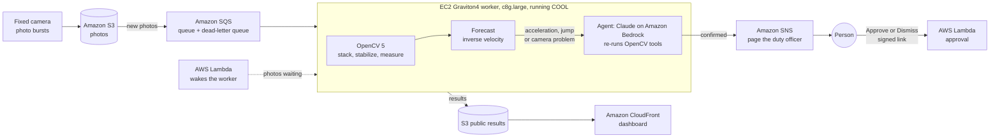
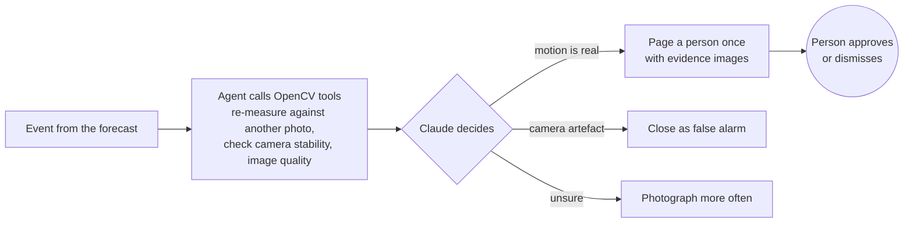

# TellTale: a camera that forecasts landslides

[](https://github.com/usv240/telltale/actions/workflows/tests.yml)

**TellTale turns any fixed camera pointed at a slope into a landslide early-warning instrument.**
OpenCV 5 measures how far the ground moves, a physics forecast gives a window for when it will
fail, an AI agent re-checks the evidence, and a person decides whether to warn the public.

Team Ground Truth (Ujwal Suresh Vanjare, Arpita Madhukar Kalburgi) · OpenCV AI Competition 2026, powered by AWS

| | |
|---|---|
| **Live dashboard** | https://d30le2uwgaimao.cloudfront.net/ |
| **Run it live on AWS** | https://d30le2uwgaimao.cloudfront.net/?site=live-demo, then press **Start a new collapse on AWS** |
| **Demo video (4:28)** | https://youtu.be/LnuL2fgPYDc |
| **Technical report** | [docs/REPORT.md](docs/REPORT.md) |
| **Ten-minute judges' path** | [docs/JUDGES.md](docs/JUDGES.md) |

## The problem

In April 2013 the Bingham Canyon copper mine in Utah saw its pit wall creep and speed up. It
cleared the pit, about 65 million cubic metres came down, and no one was hurt [1]. In July 2024
nobody was measuring the hills above Wayanad, India, and about 290 to 400 people died [2].

Many slopes creep for days or weeks before they fail, and that warning can be read. Mines read it
with radar and survey instruments that most communities cannot afford: one borehole sensor starts
at about €5,000 before drilling and watches a single point [3]. Worldwide, **half of the people
hit by a landslide in the last five years received no warning at all** [4]. The UN's Sendai
Framework asks for *"simple and low-cost early warning equipment"* [5]. TellTale is an attempt
at that: a camera a village can buy, and cents of cloud compute per day.

## How it works

1. **Watch.** A fixed camera photographs the slope in short bursts, a few times a day.
2. **Measure.** OpenCV 5 removes the camera's own shake using ground the operator marked as
   stable, then measures surface movement at about 3,000 points to a hundredth of a pixel.
3. **Forecast.** When movement accelerates, the inverse-velocity method used in mining [6, 7]
   gives a **failure window** (for example "day 49.2 to 51.0"), never a single date.
4. **Check, then ask a person.** Before anyone is woken, an agent (Claude on Amazon Bedrock)
   re-runs OpenCV on the stored photos to make sure the motion is real. Only then does it page the
   duty officer, once per episode, with the evidence images. **Nothing reaches the public unless
   a person presses Approve.**

If the camera moves, or it is dark, foggy or the lens is wet, TellTale says so (CAMERA_EVENT,
BLIND, BLURRED) instead of reporting "no movement".

## Architecture

Everything is one CloudFormation template ([infra/cloudformation.yaml](infra/cloudformation.yaml)).



- **Scale to zero:** the worker switches itself off after 20 idle minutes; a scheduled Lambda
  starts it when photos arrive.
- **Observability:** CloudWatch alarms on queue age, the dead-letter queue and a stopped worker,
  plus an ops dashboard. Every result records the OpenCV build and instance that produced it.
- **Security:** private S3 behind CloudFront, approval links signed with a key in AWS Secrets
  Manager, IMDSv2 only, no inbound ports, least-privilege roles.

The agent's loop (perception, decision, action):



Full diagrams: [docs/architecture.svg](docs/architecture.svg) and
[docs/agent_workflow.svg](docs/agent_workflow.svg).

## What it measured

Wherever possible on data we did not make.

| Test | Data | Result |
|---|---|---|
| Quiet days on a real landslide | USGS time-lapse of the Mukilteo bluff, Washington [8] | **0 false acceleration alarms in 147 quiet days** in each of three zones; 2 of 2 movement periods the camera could see were flagged |
| Real slopes that failed | Six published monitoring records [9]: Preonzo 2012 (two instrument sets), Arvigo 2007, Vajont 1963, Hogarth 1975, Veslemannen 2019 | **CRITICAL before all 6**; also 12 early alarms that settled, which is why a person decides |
| Measurement accuracy | Public SEM DIC Challenge images [10] | **0.005 px** mean error, ahead of OpenCV's Farneback and pyramidal Lucas-Kanade |
| Agent against thresholds alone | Simulated collapse with camera bumps, lighting changes and fog | Agent paged a person **41.9 time units before failure** (thresholds alone: 3.0), with no false pages |
| Graviton against x86 | Same workload, c8g.large against c7i.large | **1.6x faster**, 0.038 USD per 1,000 photos processed |
| COOL against stock OpenCV | Same Graviton instance | COOL 5.1.0-dev runs the workload and gives identical results; **5.7 to 6.6 % slower** per photo here, faster on ORB (1.45x) and corner response (1.52x). Reported as measured |
| Cost | 50 slopes sharing one worker | **About 1.40 USD per slope per month** (about 10.50 USD for a single slope) |

Every number above is checked against the saved results by one command (see Testing). Method
and limits for each test: [docs/REPORT.md](docs/REPORT.md), section 6.

## Special award evidence

### Best Use of COOL

| Requirement | Evidence |
|---|---|
| COOL version and deployment | COOL `Graviton5-COOL-v3` from AWS Marketplace (`ami-033e481a24f94c8cb`), OpenCV **5.1.0-dev**, on an EC2 **c8g.large** (Graviton4, arm64). Passed to the stack as `CoolAmiId` ([infra/cloudformation.yaml](infra/cloudformation.yaml)); [infra/worker/bootstrap.sh](infra/worker/bootstrap.sh) puts COOL's `cv2` on the worker's path |
| COOL runs the core workload | Every processed photo records which OpenCV ran it. Live, from the production worker: [series.json](https://d30le2uwgaimao.cloudfront.net/sites/demo-slope/series.json) shows `"cv2_file": "/opt/cool/python_3.12/..."`, `"opencv_version": "5.1.0-dev"`, `"cool": true`, `"instance_type": "c8g.large"`. The dashboard's Instrument health panel shows the same. `cool` is true only when `cv2` was imported from `/opt/cool` |
| Reproducible method, inputs, baselines | [evaluation/e6_cool_benchmark.py](evaluation/e6_cool_benchmark.py): a fixed 1080p workload (7-frame bursts, 3,234 measurement points), 10 warm repetitions. Baselines: stock OpenCV 5.0.0 **on the same instance**, and stock OpenCV on x86 (c7i.large). Per-operation probe: [evaluation/e6_interp_probe.py](evaluation/e6_interp_probe.py) |
| Results | Raw files in [evaluation/results/](evaluation/results/) (`e6_*.json`). COOL on Graviton is **1.49x faster and 40 % cheaper** than the usual x86 deployment, with identical results. Against stock OpenCV on the same Graviton it is 1.45x faster on ORB and 1.52x on corner response, but **6 % slower overall**, because our time is spent in float32 Lanczos warps. We tried an 8-bit search to use COOL's faster `matchTemplate` (5 % off the measuring step, accuracy unchanged) and report the rest as measured. Full write-up: [REPORT.md](docs/REPORT.md), E6 |

### Agentic Vision

| Requirement | Evidence |
|---|---|
| Agent workflow diagram | The agent-loop diagram above, and [docs/agent_workflow.svg](docs/agent_workflow.svg) (perception tools, Claude's decision, actions) |
| OpenCV output changes the next action | Same agent, same tools, opposite actions, decided by what OpenCV measured. **Real creep** ([trace](docs/agent_traces/e5/llm/creep+bump/47.json)): `motion_coherence` 0.98, `remeasure` against the previous photo and against the reference agree, so Claude calls `request_human_approval`. **Camera artefact** ([trace](docs/agent_traces/e5/llm/quiet+lens/24.3103.json)): `check_stabilization` returns CAMERA_EVENT (the mount moved 1.6 px), so Claude calls `close_event` as FALSE_ALARM and nobody is woken |
| All traces | **In the repo:** every E5 investigation, by arm (`rules`, `llm`) and scenario, in [docs/agent_traces/e5/](docs/agent_traces/e5/) (each file: tool calls, arguments, results, verdict; `agentlog.json` lists them, `pages.json` lists who was paged). **Live on AWS:** the real USGS landslide record, 34 investigations (12 confirmed, 20 closed as false alarms, 2 inconclusive): [agentlog.json](https://d30le2uwgaimao.cloudfront.net/sites/mukilteo-usgs/agentlog.json); the demo slope: [agentlog.json](https://d30le2uwgaimao.cloudfront.net/sites/demo-slope/agentlog.json). On the dashboard, click any row in Agent investigations to see the re-measured images and every tool call |
| Task success | E5 ablation (agent off, rules only, Claude on Bedrock): Claude closed every camera-distortion event as a false alarm, paged a person **41.9 time units before failure** against 3.0 for thresholds alone, with **0 false pages** ([e5_agent.json](evaluation/results/e5_agent.json)) |
| Failure handling | If Bedrock is unreachable, a rule policy drives the same tools. If the agent errors or is unsure, the worker's own CRITICAL page still fires, because a missed warning is worse than an extra one. Ten-call budget per event |
| Observability | Each trace stores the tool calls, arguments, results, verdict and duration; pages are logged in `pages.json` and human decisions in `decisions.json`; CloudWatch alarms and an ops dashboard. The traces caught a real bug, written up in [REPORT.md](docs/REPORT.md) section 6b |
| Human control | The agent cannot send a public alert. It pages once per episode with evidence images and signed Approve and Dismiss links; only a person can approve |

## Testing

Needs Python 3.11 or newer. No AWS account or network is needed.

```bash
git clone https://github.com/usv240/telltale && cd telltale
python -m venv .venv
source .venv/bin/activate                 # Windows: .venv\Scripts\activate
pip install -r pipeline/requirements.txt  # pinned: opencv-python 5.0.0.93, numpy 2.5.2, pytest 9.1.1

python evaluation/verify_claims.py        # checks every headline number, re-runs the accuracy test (~20 s)
cd pipeline && python -m pytest -q && cd ..   # unit and end-to-end tests (~15 s)
```

Run the whole worker path and the dashboard on your laptop:

```bash
python infra/scripts/seed_demo.py --local web/dashboard/demo-data
python -m http.server 8765 -d web/dashboard
# open http://127.0.0.1:8765/?root=demo-data/public/sites and use the replay slider
```

CI runs the tests, the accuracy gate and the claims check on both x86 and arm64
([.github/workflows/tests.yml](.github/workflows/tests.yml)).

## Deploy to AWS

Needs the AWS CLI v2 with credentials and `bash`.

```bash
infra/scripts/deploy.sh                         # stock OpenCV 5 on Graviton
infra/scripts/deploy.sh --cool ami-xxxxxxxx     # COOL AMI from AWS Marketplace, once subscribed
python infra/scripts/seed_demo.py --s3 telltale-<account-id> --wait
infra/scripts/teardown.sh                       # remove everything
```

Details: [infra/README.md](infra/README.md). Operators: [docs/DEPLOYMENT.md](docs/DEPLOYMENT.md).

The agent's nine OpenCV tools are also an MCP server, so any MCP client can investigate a site:

```bash
pip install -r agent/requirements-mcp.txt
python -m agent.mcp_smoke        # lists the tools and investigates the demo site
```

## Repository

| Folder | What is in it |
|---|---|
| [pipeline/](pipeline/) | The OpenCV 5 pipeline and the forecast, with a command line and tests |
| [agent/](agent/) | The supervising agent: OpenCV tools, the Claude-on-Bedrock loop, the MCP server |
| [infra/](infra/) | CloudFormation template, Graviton worker, deploy and camera upload scripts |
| [web/dashboard/](web/dashboard/) | The dashboard, the "How it works" page and the site setup tool |
| [evaluation/](evaluation/) | One script per test (E1 to E7), the saved results, and `verify_claims.py` |
| [docs/](docs/) | Report, judges' path, deployment guide, diagrams, agent traces, sources |
| [demo-rig/](demo-rig/) | A tabletop collapse rig and its capture script (not claimed as a result) |

## Limits and responsible use

- **Creep-type failures only.** Brittle collapses that do not creep first can fail with little
  warning on the surface.
- **Daylight and a clear view.** Night, fog, heavy rain and a wet lens are reported as gaps, never
  as "no movement".
- **Not yet calibrated in the field.** Results are in pixels and on the public records above; a
  printable calibration target and harness are in `evaluation/e2/`.
- **A person decides.** TellTale never sends a public alert on its own.
- **No surveillance.** Cameras point at ground. There is no person or face detection anywhere in
  the code. All data used is public or openly licensed.

**How this was built.** We used Claude Code as a coding assistant. The Agentic Vision entry rests
on the agent inside the product (Claude on Amazon Bedrock re-running OpenCV before it may page
anyone, in `agent/`), not on the coding assistant.

## References

1. Pankow, K.L., Moore, J.R., Hale, J.M., et al. (2014). Massive landslide at Utah copper mine generates wealth of geophysical data. *GSA Today* 24(1), 4. [doi:10.1130/GSATG191A.1](https://doi.org/10.1130/GSATG191A.1)
2. Petley, D. (2024). The 30 July 2024 Wayanad landslides in Kerala, India. *The Landslide Blog*, Eos. [eos.org](https://eos.org/thelandslideblog/wayanad-landslides)
3. Gamperl, M., Singer, J., Thuro, K. (2021). Internet of Things geosensor network for cost-effective landslide early warning systems. *Sensors* 21, 2609. [doi:10.3390/s21082609](https://pmc.ncbi.nlm.nih.gov/articles/PMC8068166/)
4. UNDRR and WMO (2024). *Global Status of Multi-Hazard Early Warning Systems 2024*, Box 24, citing the Lloyd's Register Foundation World Risk Poll 2023. [PDF](https://www.mhewc.org/wp-content/uploads/2025/12/Global-Status-of-EWS-2024-_opt.pdf)
5. United Nations (2015). *Sendai Framework for Disaster Risk Reduction 2015-2030*, para. 33(b). [PDF](https://documents.un.org/doc/undoc/gen/n15/167/16/pdf/n1516716.pdf)
6. Fukuzono, T. (1985). A new method for predicting the failure time of a slope. *Proc. 4th International Conference and Field Workshop on Landslides*, Tokyo.
7. Carlà, T., Intrieri, E., Di Traglia, F., et al. (2017). Guidelines on the use of inverse velocity method as a tool for setting alarm thresholds and forecasting landslides and structure collapses. *Landslides* 14, 517. [doi:10.1007/s10346-016-0731-5](https://doi.org/10.1007/s10346-016-0731-5)
8. Smith, J.B., Delius, I., Mirus, B.B., Baum, R.L. (2020). Time-lapse photography of an active coastal-bluff landslide, Mukilteo, Washington, August 2015 to May 2016. USGS data release. [doi:10.5066/P99QOYL2](https://doi.org/10.5066/P99QOYL2)
9. Leinauer, J., Weber, S., Cicoira, A., Beutel, J., Krautblatter, M. (2023). An approach for prospective forecasting of rock slope failure time. *Communications Earth & Environment* 4, 253. [doi:10.1038/s43247-023-00909-z](https://doi.org/10.1038/s43247-023-00909-z). Data, CC BY 4.0: [doi:10.14459/2023mp1688868](https://doi.org/10.14459/2023mp1688868)
10. Reu, P.L., Toussaint, E., Jones, E., et al. (2018). DIC Challenge: developing images and guidelines for evaluating accuracy and resolution of 2D analyses. *Experimental Mechanics* 58, 1067. [doi:10.1007/s11340-017-0349-0](https://doi.org/10.1007/s11340-017-0349-0)

More sources on the need for low-cost warning, each opened and quoted (WHO, India's NDMA, ISO
22327, WMO, CSIRO, the Brienz 2023 evacuation and others): [docs/PUBLISHED-RECORD.md](docs/PUBLISHED-RECORD.md).
